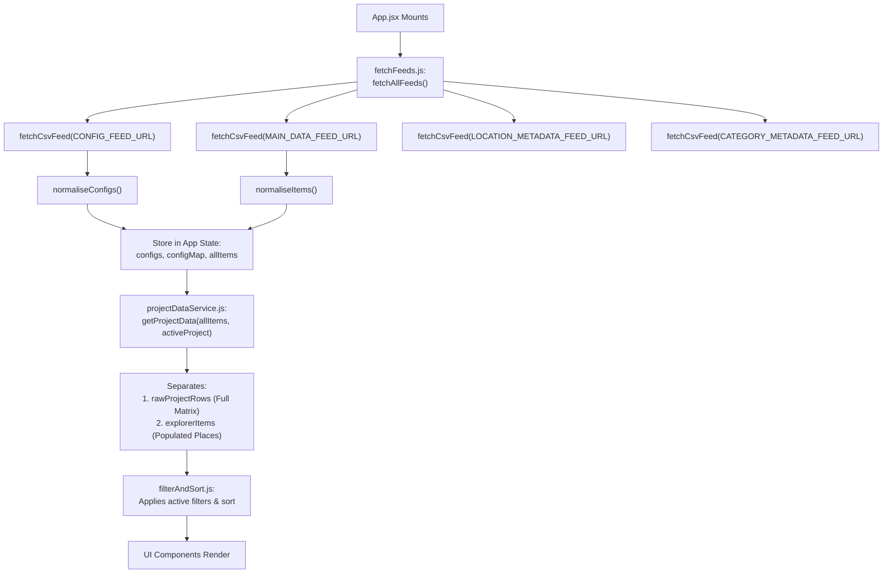

# ABC-to-Meals Reuse & Migration Audit

**Document Version:** 1.0.0  
**Status:** Architecture & Component Inspection  
**Scope:** Evaluation of copied `ABC-Public-V2` codebase for the new Meals website  

---

## 1. Current Project Architecture

The copied codebase is a modern Single Page Application (SPA) structured as follows:

* **Build Tooling:** Vite 6.0 with `@vitejs/plugin-react` (Node ESM `type: module`, port 3000).
* **Core Libraries:**
  * `react` (v18.3.1) & `react-dom` (v18.3.1)
  * `react-router-dom` (v6.28.0)
  * `lucide-react` (v0.460.0) for consistent SVG iconography
  * `leaflet` (v1.9.4) & `react-leaflet` (v4.2.1) for map rendering
  * `papaparse` (v5.4.1) for CSV parsing
  * `dompurify` (v3.4.16) for sanitizing rendered rich HTML content
  * `@fontsource/inter` (v5.1.0) for self-hosted typography
* **Styling Paradigm:**
  * Vanilla CSS with CSS Custom Properties (`src/styles/tokens.css`).
  * Modular component-level stylesheets (e.g. `FilterSidebar.css`, `GridCard.css`, `MapExplorer.css`).
  * No CSS preprocessors or heavy utility frameworks (Tailwind), ensuring zero style-build overhead and exact design fidelity.
* **State Management & Routing:**
  * Centralized React state in `src/App.jsx` (`useState`, `useMemo`, `useEffect`).
  * Custom path routing via browser `window.history.pushState` and `popstate` listeners (supporting paths like `/place/:slug`, `/location/:slug`, `/stats`).
* **Data Flow:**
  * CSV feeds downloaded via `fetch()` and parsed with `Papa.parse()`.
  * Normalized into entity objects, filtered and sorted using pure helper functions in `src/utils/filterAndSort.js`.

---

## 2. REUSE (Keep Substantially Unchanged)

These components and utilities represent battle-tested UI infrastructure and utility functions that can be carried over almost directly:

| File / Component | Purpose | Reusability Rationale |
| :--- | :--- | :--- |
| **`src/styles/tokens.css`** | Global Design System & Variables | Defines the color palette (slate neutrals, brand accents), typography (`Inter`), border radii, and elevation shadows that form the visual foundation. |
| **`src/components/Pagination/`** | Page Navigation | Fully generic pagination control (page numbers, Next/Previous buttons, disabled states). |
| **`src/components/ActiveFilterChips/`** | Active Filter Pills | Generic chip container displaying selected facets with individual remove ("x") buttons and a "Clear all" action. |
| **`src/components/ResultsToolbar/`** | Results Control Bar | Top bar featuring results counter (*"Displaying N Places"*), page size selector (Show 9, 18, 27, 36), sort dropdown, and view switcher toggles (Grid/List/Map). |
| **`src/components/MobileBottomNav/`** | Mobile Navigation Bar | Fixed bottom navigation bar with responsive icon labels and active states. |
| **`src/components/MobileSortSheet/`** | Mobile Sort Drawer | Off-canvas bottom sheet modal for choosing sort criteria on mobile viewports. |
| **`src/utils/formatUtils.js`** | Date & Text Utilities | `parseDate` and `formatDate` parse `DD/MM/YYYY` into `{ date, timestamp, formatted, isoDate }`—identical to `Meals.Date_Visited`. |
| **`src/utils/htmlSanitizer.js`** | Content Sanitization | Safe DOMPurify wrapper for rendering user comments or formatted HTML. |
| **`src/data/fetchFeeds.js` (`fetchCsvFeed`)** | Generic CSV Downloader | Promise-based fetch + PapaParse utility that downloads and parses any published Google Sheets CSV feed. |

---

## 3. ADAPT (Generalize from ABC-Specific to Meals)

These components contain excellent layout and interaction patterns, but currently reference ABC domain concepts (`place`, `county`, `category`, `status`). They should be adapted for the Meals domain:

| Component / Utility | Current ABC Role | Proposed Meals Adaptation |
| :--- | :--- | :--- |
| **`src/components/GridCard/`** | Place Card (Photo, place name, county pill, category pill, status pill) | **`MealGridCard`:** Displays meal photo (or typographic fallback), restaurant name, city/country, star rating badge, visit date, main dish tag, and comment snippet. |
| **`src/components/DesktopListCard/` & `MobileListCard/`** | Place List Item | **`MealListCard` / `MealMobileCard`:** Dense tabular/list layout showing Date, Venue, Location, Main Dish, Rating, Value (£), and Photo indicator. |
| **`src/components/FilterSidebar/`** | Desktop Faceted Sidebar (Status, County, Category, Favourites) | **`MealsFilterSidebar`:** Facets adapted to Decade/Year, Meal Rating, Country/City, Cuisine/Type, Main Ingredient, and Photo-only toggle. Retains search input, collapsible sections, and count badges. |
| **`src/components/MobileFilterSheet/`** | Mobile Filter Bottom Sheet | Adapts the same new Meals facets into the mobile slide-up sheet. |
| **`src/components/MapExplorer/`** (and `MapPopupCard`, `MapRailCard`, `MobileMapCard`) | Leaflet map plotting UK places by county | **`RestaurantMapExplorer`:** Plots global restaurant coordinates (`Rest X Cords`, `Rest Y Cords`). Popups show venue name, cuisine, Google rating, and lifetime visit count. |
| **`src/components/DesktopHeader/`** | Desktop top navbar with ProjectSelector and ABC links | **`MealsHeader`:** Removes ProjectSelector. Replaces nav links with: `Meals`, `Restaurants`, `Food`, `Places`, `Stats`. |
| **`src/components/PlaceDetailPage/`** | Place article page with blog post content | **`MealDetailPage`:** Displays visit date, restaurant snapshot, rating badge, spend (£), comment blockquote, photo gallery, main dishes ordered, and public companion tags. |
| **`src/utils/filterAndSort.js`** | Multi-field filter and sort engine | Adapts filter predicate and sort comparators to operate on Meals attributes (ratings, dates, cuisines, spend, ingredients). |

---

## 4. REPLACE (Fundamentally Tied to ABC Domain)

These components and modules are hard-coded to ABC's business logic and cannot be generalized:

1. **Target Matrix & Journey Status System:**
   * ABC invariant logic: $\text{Locations} \times \text{Categories} = \text{Target}$.
   * Journey statuses (`Blogged`, `Visited`, `Planned`, `Not planned`) and Journey Progress / Completion formulas.
   * *Replacement:* A relational meals query engine tracking actual dining occasions, visit counts, ratings, and temporal chronologies.
2. **Data Normalisation Pipeline (`src/data/normaliseItems.js`, `normaliseConfig.js`, `normaliseMetadata.js`):**
   * Processes ABC's flat `main_feed_raw.csv` and config matrix.
   * *Replacement:* A dedicated relational ingestion service (`mealsDataService.js`) that fetches the 14 agreed sheets from `MEALS_PUBLIC_DATA_CONTRACT.md`, cleans rows, normalizes types, and builds relational join maps.
3. **Dimension Pages (`DimensionIndexPage`, `DimensionDetailPage`):**
   * Renders ABC "County Index" and "Category Index" with progress bars.
   * *Replacement:* Dedicated views for `PlacesBrowse` (Countries/Cities), `FoodBrowse` (Main Dishes/Ingredients), and `RestaurantBrowse` (Venues).
4. **Statistics Engine (`src/components/StatsPage/`, `src/utils/statsCalculations.js`):**
   * Computes Target Matrix cell distributions, location progress %, and rating scores.
   * *Replacement:* A Meals Analytics dashboard computing 32-year timeline histograms, rating distributions, top restaurants visited, cuisine breakdowns, and Arsenal matchday correlations.
5. **Feed Constants (`src/data/feedConstants.js`):**
   * Hardcoded URLs pointing to ABC Google Sheets.
   * *Replacement:* Authoritative URLs for the 14 Meals worksheets.

---

## 5. REMOVE (ABC-Only Functionality with Zero Role in Meals)

The following components and files should be removed entirely:

* **`src/components/ProjectSelector/` (`ProjectSelector.jsx`, `ProjectSelector.css`):**
  * ABC features multiple isolated sub-projects (`England`, `London`, `Cornwall`). The Meals dataset is a single unified global dining history. Sub-project switching has no place in this application.
* **`src/components/PlaceholderPage/`:**
  * Development placeholder component no longer required.
* **`GEMINI.md` in root:**
  * Contains strict rules specific to ABC Public V2 (Target Matrix rules, Bayesian weighting bans, ABC release skill). It must not govern the Meals site.
* **ABC Legacy Test Scripts & Test Fixtures:**
  * `test_invariants.js`, `test_mobile_sort.js`, `detailed_inspect.js`, `inspect_feeds.js`, `generate_detailed.js`.
  * `test/category_metadata.csv`, `test/location_metadata.csv`, `test/dimensions.test.js`, `test/statsCalculations.test.js`.
  * `main_feed_raw.csv`, `config_feed_raw.csv`.

---

## 6. Existing Data Layer (How ABC Works)

The current ABC data acquisition pipeline operates synchronously on application mount:



### Key Characteristics of ABC Data Flow:
* **Flat Denormalized Ingestion:** The primary data source (`main_feed_raw.csv`) is already largely flattened into place rows containing county, category, status, date, and rating.
* **Target Baseline Dualism:** Every calculation strictly maintains two sets: `rawProjectRows` (the theoretical target) and `explorerItems` (actual places).

---

## 7. Proposed Meals Data-Layer Direction

The Meals dataset requires a **relational, join-on-load architecture** conforming to `MEALS_PUBLIC_DATA_CONTRACT.md`.

```mermaid
flowchart TD
    subgraph Ingestion["1. Parallel Feed Acquisition"]
        M[Meals CSV]
        R[Rest CSV]
        CI[City CSV]
        CO[Country CSV]
        TY[Type CSV]
        MM[Meals_Main CSV]
        FO[Food CSV]
        ING[Ingredient CSV]
        FT[FoodType CSV]
        FC[FoodCat CSV]
        PH[Meals_Photo CSV]
        MP[Meals_People CSV]
        PP[People_Public CSV]
    end

    Ingestion --> FilterClean["2. Row Cleaning & Filtering<br/>(Drop trailing formula spills, phantom rows, placeholder companions)"]
    
    FilterClean --> Normalise["3. Type Normalisation<br/>(Dates to ISO, Currency £ to Float, Booleans, Lat/Lng floats)"]

    Normalise --> BuildIndexes["4. Index Construction<br/>(Map Lookups by ID: RestMap, CityMap, CountryMap, FoodMap, PeopleMap)"]

    BuildIndexes --> AssembleEnriched["5. Enriched Meal Assembly<br/>(Join Meal ──► Restaurant ──► City ──► Country<br/>Join Meal ──► Meals_Main[] ──► Food ──► Ingredient<br/>Join Meal ──► Photos[]<br/>Join Meal ──► Companions[])"]

    AssembleEnriched --> CacheStore["6. MealsDataService Store<br/>- enrichedMeals[] (4,776 items)<br/>- restaurants[] (3,055 venues)<br/>- placesHierarchy (Countries & Cities)<br/>- foodCatalog (Dishes & Ingredients)"]

    CacheStore --> UIHooks["7. React Application Consumption<br/>useMealsData() / App.jsx"]
```



### Implementation Decisions:
1. **Reuse `fetchCsvFeed`:** Download all 14 sheets in parallel using `Promise.allSettled` or `Promise.all`.
2. **Dedicated `mealsDataService.js`:** Encapsulates row filtering, normalisation, index building, and assembly away from UI components.
3. **Runtime Joining:** Performed once during initial intake. Because the entire dataset across 14 sheets is only ~5 MB in memory, client-side relational joining completes in **< 150 milliseconds**.
4. **Resilient Failure Handling:** If an orphan ID is encountered (such as `Rest_ID` 2655 or `Food_ID` 6), the service assigns `null` to the related entity rather than crashing the loader.

---

## 8. Visual Design System to Preserve

To ensure the new Meals website retains the clean, premium feel of `ABC-Public-V2`, the following visual foundations will be preserved:

* **Typography & Hierarchy:**
  * Font Family: `Inter`, system fallbacks (`-apple-system`, `Segoe UI`, `Roboto`).
  * Headings: Crisp semi-bold/bold weights (`600`, `700`) with tight letter spacing (`-0.015em`).
  * Body & Captions: Clean regular/medium weights (`400`, `500`) with high legibility (`line-height: 1.5`).
* **Color Palette (`tokens.css`):**
  * Canvas: Soft light gray background (`--bg-page: #f8fafc`).
  * Surfaces: Crisp pure white card & panel background (`--bg-surface: #ffffff`).
  * Borders: Subtle slate dividing lines (`--border: #e2e8f0`).
  * Text: High-contrast slate typography (`--text-primary: #0f172a`, `--text-secondary: #475569`, `--text-muted: #64748b`).
  * Accents: Vibrant blue interactive elements (`--accent: #2563eb`).
* **Card Anatomy:**
  * Border radius: 12px (`--radius-lg`).
  * Subtle card elevation: `box-shadow: 0 1px 3px rgba(0,0,0,0.05), 0 1px 2px rgba(0,0,0,0.02)`.
  * Media container: Fixed aspect ratio (16:10) with smooth overflow clipping.
  * Metadata chips: Rounded pill shapes (`--radius-full`) with light neutral backgrounds (`#f1f5f9`).
* **Faceted Search Layout:**
  * Two-column desktop grid: 280px left sidebar + fluid 3-column card grid.
  * Active filter chips bar situated directly above results.
  * Results counter and sort dropdown aligned on the toolbar.
* **Mobile Behaviour:**
  * Sticky header with search trigger and filter button displaying active count badge.
  * Smooth off-canvas bottom sheet modals for filtering and sorting.
  * Bottom navigation tab bar for thumb-friendly mobile section switching.

---

## 9. Firebase References Requiring Replacement

The copied project currently contains active references to ABC's live Firebase production setup. These must **never** be used for deployment:

1. **`.firebaserc` (Root):**
   ```json
   {
     "projects": {
       "default": "abc-tour-d3452"
     }
   }
   ```
   * *Action:* Must be replaced with the new Meals Firebase project ID when created.
2. **`firebase.json` (Root):**
   * Specifies `public: "dist"` and client-side SPA URL rewrites to `/index.html`.
   * *Action:* The routing rule structure is valid, but deployment must remain locked until the new project is assigned.
3. **`package.json`:**
   * `"name": "abc-public-v2"`
   * *Action:* Rename to `"meals-public"`.
4. **`index.html`:**
   * `<title>ABC Public v2 – Explorer</title>`
   * *Action:* Update to `<title>Meals – 32 Years of Dining History</title>`.

---

## 10. Git / Repository Safety Check

* **`.git` Folder Check:** Verified absent. No `.git` folder exists in this workspace directory (`Test-Path .git` returned `False`).
* **Git Remotes:** No git remotes are attached.
* **Remote Upstream References:** Completely detached. There is zero risk of accidental pushes or commits to ABC Public V2.

---

## 11. Recommended First Implementation Slice

Rather than attempting to build the entire 5-section site at once, we recommend delivering a **single, highly focused vertical slice**:

### The "Core Meal Chronicle" Vertical Slice:
1. **Data Ingestion Service (`src/data/mealsDataService.js`):**
   * Fetch and join the 7 core sheets: `Meals`, `Rest`, `City`, `Country`, `Meals_Main`, `Food`, `Meals_Photo`.
   * Produce the enriched `Meal` objects.
2. **Simplified Application Shell (`src/App.jsx`):**
   * Top bar: Simplified header showing Meals branding.
   * Main section: `ResultsToolbar` + `MealGridCard` list + `Pagination`.
   * Detail view: Clicking a card opens `MealDetailPage` displaying date, venue, location, ratings, comments, main dish, and photos.
3. **Adaptive Card Rendering:**
   * Validates photo rendering for meals with photos, and elegant typographic fallbacks for meals without photos.

### Why This Slice First?
It proves the **entire relational pipeline end-to-end**—from live Google Sheets CSV parsing, relational key joining, and React state hydration, to responsive card rendering and detail navigation—with zero lingering ABC domain dependencies.

---

## 12. Risks / Things Not To Copy

1. **Do NOT port the ABC Target Matrix invariants:** Meals is a historical log of actual occurrences, not a finite combinatorial matrix of counties and categories.
2. **Do NOT port the Project Selector:** Meals is a single global archive; introducing project selection adds artificial complexity.
3. **Do NOT port raw `People` handling:** Adhere strictly to privacy rules using only `People_Public`.
4. **Do NOT assume every meal has an image:** Designing card layouts that break when photos are absent is the biggest visual risk.
5. **Do NOT copy `GEMINI.md` rules into Meals:** The rules in `GEMINI.md` reference ABC-specific verification scripts and architectural constraints.

---

## 13. Recommended Implementation Sequence

```text
Phase 1: Workspace Sanitation & Project Identity
 ├── Rename package.json ("meals-public") and index.html title
 ├── Disarm .firebaserc (clear default project)
 └── Remove obsolete ABC test files and GEMINI.md

Phase 2: Relational Ingestion Engine (The Data Backbone)
 ├── Define feedConstants.js with 14 authoritative Meals URLs
 ├── Implement mealsDataService.js (cleaning, normalisation, joins)
 └── Validate join integrity in memory

Phase 3: The Core Vertical Slice (Meals Chronicle)
 ├── Adapt DesktopHeader & App shell
 ├── Adapt GridCard → MealGridCard (with adaptive photo layout)
 ├── Adapt ResultsToolbar & Pagination
 └── Adapt PlaceDetailPage → MealDetailPage

Phase 4: Faceted Search & Filtering
 ├── Adapt FilterSidebar with Meals facets (Decade, Rating, Cuisine, Country, Photos)
 └── Adapt filterAndSort.js for multi-attribute Meals queries

Phase 5: Venue & Geographical Exploration
 ├── Adapt MapExplorer with Leaflet for global restaurant coordinates
 ├── Build Restaurant Browse & Detail views
 └── Build Places (Country & City) Index

Phase 6: Gastronomy & Analytics
 ├── Build Food Explorer (Main dishes by ingredient and cuisine)
 └── Build StatsPage (32-year timeline, rating breakdown, top venues)

Phase 7: Mobile Polish & Production Readiness
 ├── Connect MobileBottomNav and MobileFilterSheet
 └── Create and link new Meals Firebase project
```

---

### Audit Sign-off

* **Who should test this:** **Agent** (self-verified architecture audit).
* **Firebase preview required:** **NO** (inspection and planning task only; no deployment or build changes executed).
