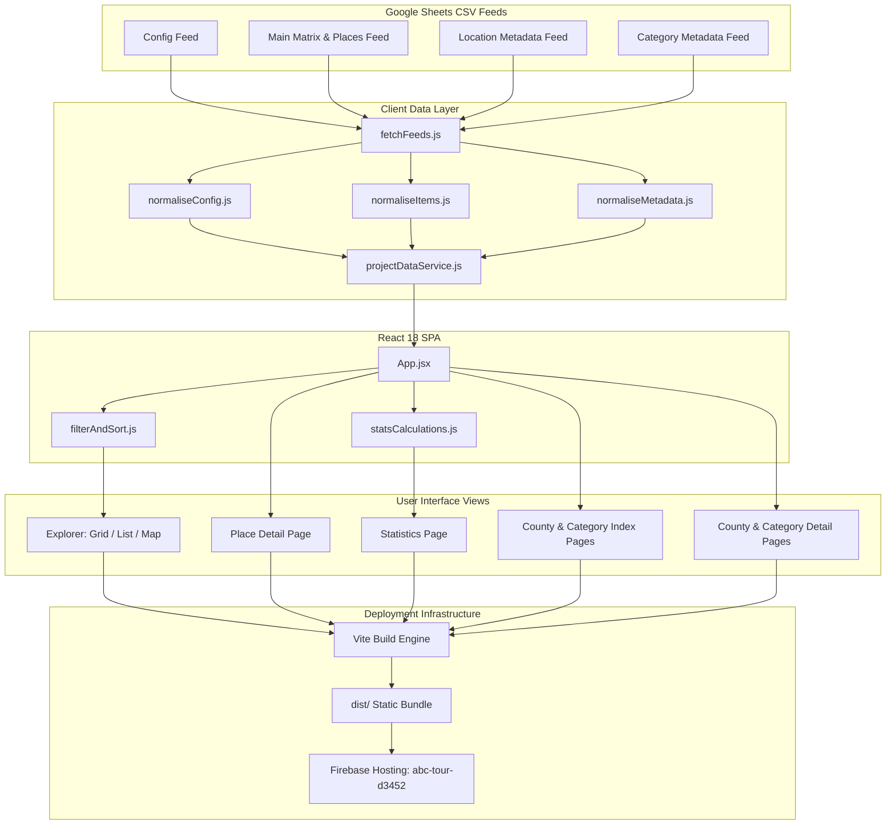

# ABC Public V2 — Architecture & Specification Document

> **Live Website:** [https://abc-tour-d3452.web.app](https://abc-tour-d3452.web.app)  
> **Source Repository:** [stevethenoncoder/ABC-Public-V2](https://github.com/stevethenoncoder/ABC-Public-V2) (`main` branch)  
> **Hosting Platform:** Google Firebase Hosting (`abc-tour-d3452`)

---

## 1. Executive Summary & Purpose

**ABC Public V2** is a high-performance, responsive Single-Page Application (SPA) replacing the legacy ABC V1 website. It documents an ongoing journey to visit and chronicle a comprehensive target matrix of **Locations × Categories** across multiple projects (e.g., England's 48 Ceremonial Counties × 26 Categories = 1,248 target combinations, London's 33 Boroughs, etc.).

The application serves three distinct core objectives:
1. **Public Explorer & Chronicles:** An engaging public blog and directory where visitors discover places, read travel reports, view curated photography, watch embedded YouTube videos, inspect interactive Google Maps, and filter by statuses, dates, ratings, and favourites.
2. **Dimension Overviews & County/Category Deep Dives:** Detailed exploratory pages for every individual county and category (`/location/:name` and `/category/:name`), featuring peer rank KPIs, highlighted blog favourites, collapsible & sortable entry tables, dedicated mini-maps with place labels, and research placeholders.
3. **Journey & Progress Analytics:** A data-driven analytical dashboard (Statistics) illustrating progression through the complete project target matrix, showing completion velocity over continuous monthly timelines, rating distributions, and category/location completion rankings.

---

## 2. Core Architecture & Technology Stack



### Technology Highlights
- **Core Framework:** React 18.x with functional components and React Hooks (`useState`, `useMemo`, `useEffect`, `useCallback`, `useRef`).
- **Build Tool & Bundler:** [Vite 6](https://vite.dev) with native ES module loading, instant HMR, optimized chunking, and gzip compression.
- **Icons & UI Symbols:** [lucide-react](https://lucide.dev) lightweight SVG icons.
- **HTML Sanitization:** [DOMPurify](https://github.com/cure53/DOMPurify) configured with a strict security policy (preventing XSS while rendering approved typography and HTML content).
- **Typography & Font System:** `@fontsource/inter` (weights 400, 500, 600, 700) self-hosted to ensure offline availability and zero external render-blocking font dependencies.
- **Map Visualizations:** Leaflet / React-Leaflet with OpenStreetMap tiles, custom SVG status pins, favourite heart badges, auto-bounding controller, and Google Maps embed integration.
- **Hosting & Infrastructure:** Google Firebase Hosting with SPA client-side rewrite rules (`**` $\rightarrow$ `/index.html`).

---

## 3. Data Architecture & Ingestion Pipeline

### Feed Normalisation Pipeline
Data is ingested directly from published Google Sheets CSV endpoints:
1. **Config Feed (`CONFIG_FEED_URL`):** Defines project metadata (Project Key, Title, Subtitle, Location labels, and status placeholder fallback texts).
2. **Main Feed (`MAIN_FEED_URL`):** Defines the full matrix of places and target slots.
3. **Location Metadata Feed (`LOCATION_METADATA_FEED_URL`):** Defines county/borough editorial copy, tags, overview imagery, and curated metadata.
4. **Category Metadata Feed (`CATEGORY_METADATA_FEED_URL`):** Defines category editorial copy, tags, overview imagery, and curated metadata.

### Data Model Separation
A foundational tenet of ABC V2 is the architectural separation between two datasets:
- **Target Matrix Rows (`rawProjectRows`):** Contains every defined row in the Google Sheet representing Location $\times$ Category combinations. Powers target totals, county/category targets, and completeness calculations.
- **Populated Places (`explorerItems`):** Real public entries that possess a populated place name. Powers Explorer cards, search, date filtering, ratings, timeline history, and blog posts.

### Normalised Place Entity (`ExplorerItem`)
| Field | Type | Description |
|---|---|---|
| `projectKey` | `string` | Project identifier (e.g. `'England'`, `'London'`) |
| `place` | `string` | Name of the location or destination |
| `location` | `string` | County or borough name |
| `category` | `string` | Project theme / category |
| `status` | `'Blogged' \| 'Visited' \| 'Planned' \| 'Not planned'` | Canonical 4-state lifecycle status |
| `photo` | `string \| null` | Curated cover photo URL (sanitized against placeholders) |
| `rating` | `number \| null` | Numeric rating score from `1.0` to `5.0` |
| `ratingLabel` | `string \| null` | Original rating text (e.g. `'4/5 - Very Good'`) |
| `date` | `string \| null` | Visit / planned date in `DD/MM/YYYY` format |
| `favourite` | `boolean` | Flag indicating whether the place is marked as a personal favourite |
| `content` | `string \| null` | Sanitized article/blog HTML (DOMPurified, strictly excluding iframes) |
| `video` | `string \| null` | Dedicated, validated YouTube embed URL (`https://www.youtube.com/embed/VIDEOID`) |
| `googleMapEmbed` | `string \| null` | Dedicated, validated Google Maps embed URL |
| `latitude` / `longitude` | `number \| null` | Geocoordinates for interactive map positioning |

---

## 4. Key Functional Features & Screen Layouts

### 4.1. Desktop Explorer Page
- **Header Toolbar:** Global branding, project selector pill toggle (`England` / `London`), top navigation links (`Blogs`, `Stats`, `Counties`, `Categories`, `About`), bookmarks shortcut, and user status.
- **Desktop Hero Banner:**
  - Displays dynamic project title and subtitle.
  - **Journey Status Lozenge:** An executive, rounded visual pill on the right side of the hero displaying a multi-colored segmented progress bar (**Blogged** in green, **Visited** in blue, **Planned** in orange, and **Not planned** in gray), with detailed counts accessible on hover.
- **Filter Sidebar:**
  - Full-text search with instant clear button.
  - **Favourites Only** toggle.
  - **Status Filter:** Selectable faceted checkboxes with dynamic badge counts.
  - **Counties / Locations Filter:** Searchable list of locations with multi-select support and count tallies.
  - **Categories Filter:** Searchable list of categories with multi-select support and count tallies.
  - **Rating Filter:** Filter by minimum star rating ($3+$, $4+$, $5$ stars).
  - **Date Range Filter:** Dynamic start/end month picker filtering by place dates.
- **Results Toolbar:** Result count indicator, active filter chips with individual removal, page size selector (`18`, `36`, `72`), multi-criteria sorting (`Date desc/asc`, `Rating desc/asc`, `Name asc/desc`), and view mode switcher (**Grid**, **List**, **Map**).
- **Cards & Place Presentation:**
  - High-resolution cover photos with smooth fallbacks to project-specific placeholder texts.
  - Status badges, visit date indicators, star ratings, and category pills.
  - Client-side routing to detail views via pushState (`/place/{slug}`).

### 4.2. Mobile Header & Controls Toolbar
- **Compact Top Bar:** Engineered to be as narrow as possible in depth to maximize screen real estate.
  - **Brand Badge:** Compact `A^Z` logo badge on the left.
  - **Mobile Project Title:** Sourced directly from `projectTitleMobile` / `Project Title - Mobile` in the config feed (e.g. `'A to Z - England'`, `'A to Z - London'`). Truncates cleanly if necessary.
  - **Round Project Selector:** A space-efficient, circular selector in the top-right corner displaying `'E'` (England) or `'L'` (London) with responsive active feedback. Tapping the selector cycles seamlessly to the alternate project.
- **Controls & Filters Row:** Compact buttons for Filter (with active indicator dot), Sort, and Map/List toggle.
- **Count Indicator:** Lightweight places count display (`Displaying X places`).

### 4.3. Map Explorer View (`viewMode: 'map'`)
- **Map Canvas & Tiles:** Responsive OpenStreetMap canvas with Leaflet.
- **Dynamic Markers:** Custom SVG map pins colored by status (`#10b981`, `#3b82f6`, `#f59e0b`, `#94a3b8`), with an inner white core, drop shadow, and red heart badge for favourites.
- **Place Name Labels:** Small, rounded text labels displayed underneath map pins (`.marker-text-label`).
- **Label Toggle:** Checkbox toggle ("Show Label") in the results rail header (desktop) and floating pill (mobile).
- **Auto-Bounds Controller:** `MapViewController` dynamically tracks item collections and fits map bounds with generous padding whenever filters or dimensions change.
- **Companion Results Rail (Desktop):** Scrollable sidebar showing matching place cards; clicking any card pans smoothly to the pin and opens its rich popup.
- **Mobile Experience:** Companion rail collapses; tapping pins opens a bottom floating drawer card.

### 4.3. County & Category Index Pages (`/locations` and `/categories`)
- **Directory Grid:** Displays full card directory for all counties in the project or all categories.
- **Search & Filter:** Search bar to quickly find dimensions, plus status and rating filter chips.
- **Dimension Cards:** Show cover photo/placeholder, progress status bar, target count, blogged places count, rating score %, and ordinal peer rank.
- **Navigation:** Clicking any dimension card navigates to `/location/:name` or `/category/:name`.

### 4.4. County & Category Detail Pages (`/location/:name` and `/category/:name`)
- **Header & Navigation:** Contextual breadcrumbs (`Counties > Norfolk` or `Categories > Architecture`) and back button returning to the parent index.
- **Executive KPI Cards (3-column top grid):**
  1. **Journey Status / Progress:** Blogged count vs. Target matrix combinations with completion %, ordinal peer rank (e.g. `1st`), and in-context peer minimum and maximum figures with named badges (e.g. `min 3 [Cornwall] · max 13 [Norfolk]`).
  2. **Rating Score:** Percentage score calculated via $\sum \text{ratings} / (\text{ratedCount} \times 5)$, displaying ordinal rank, sample size, and in-context peer minimum/maximum scores with named badges.
  3. **Target Matrix / Overview:** Target combinations, populated places count, and latest visit date.
- **Blog Entry Favourites So Far:** Highlighted section bounded by a card, showcasing entries marked as favourites with tags derived from metadata.
- **My Entries Collapsible Panel:**
  - Full-width table of all places for this county or category.
  - Starts collapsed showing the first 3 entries, expandable via an interactive toggle.
  - Heading-based sorting by any column (Place, Location/Category, Favourite, Status, Rating, Date).
  - Favourite heart column (3rd column).
  - Filter toggle button: **"Display Not Planned"** / **"Remove Not Planned"** to include or exclude unscheduled matrix slots.
  - Clicking any entry navigates to `/place/:slug` with a return context preserved (`Back to Norfolk`).
- **Bottom Two-Column Grid:**
  - **Map of Posts:** Dedicated Leaflet mini-map encompassing all places in the dimension.
    - **Default Labels:** Small place-name labels visible initially beneath pins.
    - **Toggle Control:** Floating "Show labels" checkbox in the upper-right corner.
    - **"View all X places →" button:** Seamlessly navigates to the Explorer in **Map View** (`viewMode: 'map'`), with **Show labels turned ON** and bounds centered on the filtered places.
  - **My Research Panel:** Curated placeholder panel with Flask/Book iconography and "Coming soon" badge for field notes, route planning, and background research.

### 4.5. Place Detail Page (`/place/:slug`)
- **Contextual Back Navigation:** Intelligently returns to wherever the user came from (e.g., `Back to Norfolk`, `Back to Architecture`, `Back to Stats`, or `Back to Explorer`).
- **Header & Hero:** Place title, category chip, location indicator, canonical status badge, rating score, and visit date.
- **Photography:** Full-width hero image with caption and photography credit.
- **Sanitized Blog Content:** Sanitized article HTML cleanly styled with typography tokens.
- **Structured YouTube Video Section:** Dedicated 16:9 responsive video container with lazy loading and full-screen controls, strictly validated against YouTube URLs.
- **Location & Google Map Section:** Dedicated responsive map container rendering validated Google Maps embeds alongside coordinates.

### 4.6. Statistics Dashboard (`StatsPage`)
- **Dynamic Scope Title:** **`ABC Statistics`** with project context (`Project: England — 48 counties × 26 categories`), updating to **`Target Matrix [Filtered]`** under active filtering.
- **Executive Metric Cards:** Target, Locations, Categories, Not planned, Planned, Visited, Blogged, Rating, and Favourites.
- **Journey Status Distribution:** Scaled horizontal stacked bar with inline legend.
- **Activity Timeline:**
  - Toggle between **Monthly Activity** and **Cumulative Journey**.
  - **Monthly Activity:** Continuous monthly bar columns filling all intervening months.
  - **Cumulative Journey:** Smooth SVG line chart tracking blogged velocity with emerald shadow gradient.
- **Progress Tables (Two-Column Comparison):**
  - **Progress by Location:** Sortable by Location Name, Journey Progress %, Rating Score %, and Ratings Count.
  - **Progress by Category:** Sortable by Category Name, Journey Progress %, Rating Score %, and Ratings Count.

---

## 5. Design System & Visual Tokens

| Token / Concept | Value | Usage |
|---|---|---|
| **Blogged (Complete)** | `#10b981` (Emerald Green) | Fully completed places, primary progress metrics, gradient shadows |
| **Visited** | `#3b82f6` (Royal Blue) | Visited destinations pending blog completion |
| **Planned** | `#f59e0b` (Amber / Orange) | Scheduled destinations |
| **Not planned / Unscheduled** | `#94a3b8` (Slate Gray) | Unscheduled matrix target slots |
| **Favourites** | `#ef4444` (Crimson Red) | Favorited destination hearts and badges |
| **Page Background** | `#f8fafc` (Slate 50) | Main background |
| **Surface Background** | `#ffffff` (White) | Cards, sidebars, modals, toolbars |
| **Borders** | `#e2e8f0` (Slate 200) | Structural dividers and card boundaries |
| **Text Primary** | `#0f172a` (Slate 900) | Headings, primary metrics, titles |
| **Text Secondary / Muted** | `#64748b` (Slate 500) | Subtitles, labels, metadata |

---

## 6. Engineering Management & Release Processes

### 1. Continuous Invariant Testing
All mathematical rules, target calculations, rating formulas, and normalisation helpers are verified using automated ESM test suites:
- `test/statsCalculations.test.js`: 16 invariant tests asserting baseline multipliers, filter independence, rating score mathematics, and timeline continuity.
- `test/dimensions.test.js`: 12 invariant tests asserting location/category targets, peer rank calculations, ordinal formatting, and composite metadata lookups.
- `test/videoAndSanitizer.test.js`: Validates YouTube URL parsing across standard, shortened, and shorts formats, while verifying strict iframe rejection.

### 2. Version Control Checkpointing (Git)
- Repository: `stevethenoncoder/ABC-Public-V2` on branch `main`.
- All milestone features are unit-tested and verified with `npm run build` before commits are authored.

### 3. Production Deployment (Firebase Hosting)
- **Target Project:** `abc-tour-d3452`
- **Live Hosting Site:** `https://abc-tour-d3452.web.app`
- **Build Pipeline:**
  ```bash
  npm run build
  firebase deploy --only hosting --project abc-tour-d3452
  ```
- **Configuration:**
  - `.firebaserc`: Targets project `abc-tour-d3452`.
  - `firebase.json`: Serves `dist/` with catch-all rewrite rules to support deep-linking client URLs (`/place/:slug`, `/location/:name`, `/category/:name`).
