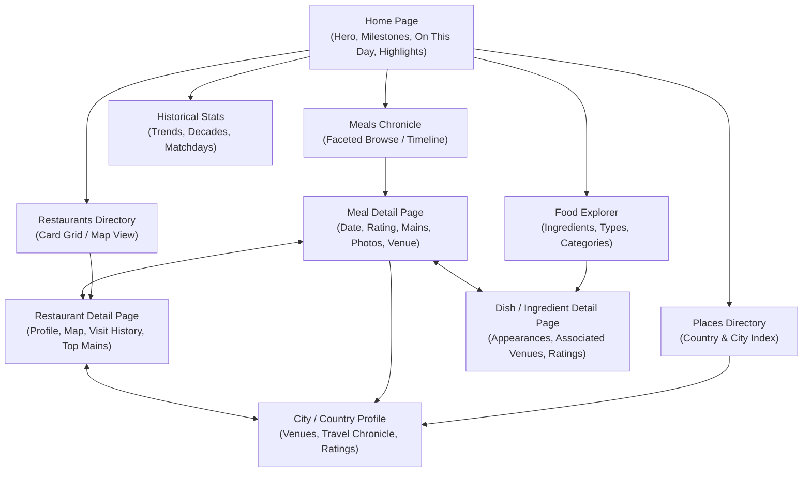

# Meals Website: Information Architecture & UX Design

**Document Version:** 1.0.0  
**Status:** Approved Architectural Design  
**Scope:** Information Architecture, Navigation, Content Hierarchy, and UX Strategy  

---

## 1. Product Concept

The **Meals Website** is an interactive, personal dining archive spanning **over 32 years of culinary exploration** (1994 to 2026). Comprising over **4,700 individual meals**, **3,000 restaurants**, **55 countries**, and thousands of cataloged dishes, this archive represents a lifetime of food experiences, travel memories, social dining, and candid gastronomic commentary.

Rather than feeling like an administrative inventory or a sterile review portal (like Yelp or TripAdvisor), the site is designed as a **rich, warm, biographical gastronomic journal**. It balances deep historical data with vibrant discovery—inviting visitors to browse chronologically across decades, explore favourite cuisines and ingredients, retrace international travels, examine personal rating distributions, and observe how dining habits evolved from 1994 to the present day.

---

## 2. Recommended Navigation

To keep the interface clean, approachable, and focused on core user journeys, we recommend a streamlined **5-item primary navigation**:

```text
[ Brand / Logo: MEALS ]
├── Meals         (The Core Chronicle / Timeline)
├── Restaurants   (The Venues & Interactive Map)
├── Food          (Main Dishes, Ingredients & Cuisines)
├── Places        (Countries & Cities Travel Directory)
└── Stats         (Longitudinal Trends & Historical Insights)
```

### Why This Structure?
1. **Meals (The Chronicle):** The central transaction and heartbeat of the site. Allows users to browse every dining event by date, rating, sentiment, companion, or search query.
2. **Restaurants (Venues):** Focuses on places where meals were eaten—supporting repeat visit analysis, venue ratings, geographic clustering, and venue search.
3. **Food (Gastronomy):** Focuses on *what* was eaten (main dishes, dominant ingredients, culinary styles), providing a culinary lens distinct from geographical venue lookups.
4. **Places (Geography & Travel):** Groups dining history by Country and City. Ideal for exploring holiday dining, foreign trips, and city-by-city summaries.
5. **Stats (The 30-Year Story):** Celebrates the sheer longevity and scale of the 32-year dataset (annual volumes, rating shifts, Arsenal matchday correlations, milestone meals).

### What is Deliberately Left Out of Top-Level Navigation:
* **Home:** Handled naturally by clicking the site brand/logo.
* **People / Companions:** Omitted from top-level navigation. Because 90% of companion records are privacy-masked as `"Hidden name"` under `People_Public`, a top-level "People" directory would expose a list dominated by anonymized entries. Instead, companion discovery lives as a filter facet on Meals, contextual tags on Meal detail cards, and an aggregate module within `Stats`.
* **Starters / Desserts:** Excluded completely in accordance with the agreed data contract scope.

---

## 3. Information Architecture

The website’s information architecture is strictly relational and bi-directionally linked, reflecting the underlying data contract:



### Inter-Entity Navigation Matrix
* From a **Meal**, users can click through to:
  * The **Restaurant** profile.
  * The **City** or **Country** page.
  * Any **Main Dish** or **Ingredient** detail.
  * Filter the main chronicle by that date's **Year**, **Rating**, or **Companion**.
* From a **Restaurant**, users can view:
  * Every historic meal eaten there (sorted newest to oldest).
  * The dishes ordered across all visits.
  * The City / Country it belongs to.
* From a **Food Item** (e.g. *Fillet of Beef* or *Squid*), users can view:
  * Every meal where that dish was ordered as a main course.
  * Which restaurants served it and how highly it was rated.

---

## 4. Home Page

The Home Page acts as a compelling front door that immediately communicates the unique breadth of the collection (32 years of dining) and offers varied discovery pathways:

### Recommended Content Hierarchy (Top to Bottom):

1. **Editorial Hero & Key Metrics Banner:**
   * Headline: *A 32-Year Personal Dining Odyssey (1994–2026)*.
   * Quick-Stat Pills: `4,776+ Meals` · `3,055 Restaurants` · `55 Countries` · `2,000+ Photographs`.
   * Prominent omni-search input (*"Search by dish, restaurant, city, or year..."*).
2. **"On This Day" (Historical Serendipity):**
   * Surfaces meals eaten on today’s calendar date in previous years (e.g., *"On 27 October: 6 meals between 1996 and 2024"*).
   * Instantly highlights the temporal depth of the project.
3. **Latest Dining Experiences (Recent Feed):**
   * Carousel or grid of the 4 most recent meals with photos, venue, star ratings, and snippet comments.
4. **"The Hall of Fame" (Exceptional & Top-Rated):**
   * Curated quick-access tabs:
     * *The 3-Star / Exceptional Hall of Fame* (`Meal_Rating == 'Exceptional'` or `'The Dogs'`).
     * *Most Visited Venues* (local haunts with 10+ visits).
5. **Visual Photo Mosaic / Recent Imagery:**
   * A responsive strip of recent food and restaurant photography linking directly to their respective meal pages.
6. **Exploration Portals:**
   * Four visual entrance cards:
     * **By Decade:** *The 90s, 2000s, 2010s, 2020s*.
     * **By Cuisine:** *Italian, French, Japanese, Gastropub, Tapas, Indian*.
     * **By Destination:** *London Haunts, European Escapes, Americas, Asia*.
     * **Matchday Meals:** *Arsenal Matchday Dining History*.
7. **Random Meal Discovery Button:**
   * A fun, serendipitous *"Surprise Me with a Random Meal"* feature.

---

## 5. Meal Browse Page (The Chronicle)

The primary search and browsing engine for the 4,776 meals, inspired by the clean, faceted layout of `ABC-Public-V2`.

```text
┌───────────────────────────────────────────────────────────────────────────────────────┐
│ [ Search Meals... ]                             Show: [ 24 ]  Sort: [ Date (Newest) ]  │
├─────────────────────┬─────────────────────────────────────────────────────────────────┤
│ FILTERS             │ Displaying 4,776 Meals                 [ Grid ] [ List ] [ Timeline]
│                     ├─────────────────────────────────────────────────────────────────┤
│ Active: [London x]  │ ┌──────────────┐ ┌──────────────┐ ┌──────────────┐ ┌──────────┐ │
│                     │ │ [Image]      │ │ [No Image]   │ │ [Image]      │ │ [Image]  │ │
│ Decade              │ │ Tribeca Grill│ │ St. John     │ │ Chez Bruce   │ │ ...      │ │
│ [ ] 2020s (1,240)   │ │ New York, USA│ │ London, UK   │ │ London, UK   │ │          │ │
│ [ ] 2010s (1,850)   │ │ ★ Superb     │ │ ★ Exceptional│ │ ★ Very Good  │ │          │ │
│ [ ] 2000s (1,120)   │ │ 14 Oct 2025  │ │ 02 Jun 2001  │ │ 18 Mar 2018  │ │          │ │
│ [ ] 1990s (566)     │ │ Fillet Steak │ │ Roast Bone   │ │ Lamb Rump    │ │          │ │
│                     │ └──────────────┘ └──────────────┘ └──────────────┘ └──────────┘ │
│ Rating              │                                                                 │
│ [ ] Exceptional(376)│                                                                 │
│ [ ] Very Good (2293)│                                                                 │
│ ...                 │                                                                 │
└─────────────────────┴─────────────────────────────────────────────────────────────────┘
```

### Layout & Controls:
* **Two-Column Responsive Grid:**
  * **Left Sidebar (Desktop):** Faceted filters with hit-counts, collapsible accordions, and a "Clear All" button.
  * **Main Content Area:** Active filter pill tags, results counter, sort dropdown, page-size selector, and view-mode toggles.
* **View Modes:**
  1. **Card Grid View (Default):** Rich visual cards showing photo (or stylized typographic fallback), restaurant name, city/country, visit date, overall rating badge, main dish tag, and comment snippet.
  2. **Compact List View:** High-density table/list showing Date, Venue, Location, Main Dish, Rating, Value (£), and Photo icon. Excellent for power browsing and chronological scanning.
  3. **Timeline View:** Chronological groupings separated by Year headers with year-level aggregate summaries (e.g., *"1998 — 142 Meals, 8 Countries"*).
* **Sorting Options:**
  * Date (Newest first / Oldest first).
  * Rating (Highest first / Lowest first).
  * Value / Spend (Highest / Lowest).
  * Restaurant Name (A–Z).

---

## 6. Meal Detail Page

The Meal record is the central hero of the site. Its detail page provides complete narrative context for that specific dining occasion:

### Recommended Content Hierarchy:

1. **Header & Contextual Badges:**
   * Restaurant Name (linked to Restaurant Detail).
   * Location Breadcrumb: `Country` → `City` → `Restaurant`.
   * Date Visited: Full friendly format (e.g. *Tuesday, 14 October 2025*).
   * Value / Spend: Formatted GBP (e.g. `£35.00`), tagged as Business or Leisure (`Business == true` pill).
   * Rating Hero Badge: Prominent visual rating (e.g. `Very Good`, `Exceptional`).
   * Sentiment Pill: e.g., `Delighted` (Positive), `Disappointed` (Negative).
2. **Arsenal Matchday Callout (Conditional):**
   * Appears *only* if `AFC_Game == true`.
   * Stylized banner: *"Arsenal Matchday: Arsenal 2 - 1 Chelsea. Pre-match dinner."* Displays `AFC_Opponent`, scores, and `AFC_Comment`.
3. **The Personal Review / Comment:**
   * Blockquote callout displaying the candid personal `Comment` recorded for that visit.
4. **Photo Gallery:**
   * If photos exist in `Meals_Photo`, render a responsive lightbox gallery with captions (`Photo_Comment`).
   * If no photo exists, omit the photo container cleanly without empty placeholders.
5. **Main Courses Ordered (`Meals_Main`):**
   * Distinct dish cards for each main course recorded:
     * Dish Name (`Food.Food_Text`).
     * Dish Rating (`Main_Rating`, e.g. `Superb`, `Good`).
     * Dish Comment (if available).
     * Categorical Pills: `FoodType` (e.g. *Steak*), `Ingredient` (e.g. *Beef*), `FoodCat` (e.g. *Meat*). Each pill links to filtered food views.
6. **Dining Companions:**
   * Companion list derived strictly from `Meals_People` → `People_Public`.
   * Badges displaying `Public_Name`. (Displays `"David Smith"`, `"Sarah Jones"`, or `"Hidden name"`—respecting privacy rules).
7. **Restaurant Snapshot Card:**
   * Mini-map displaying venue coordinates.
   * Address, Cuisine Type, Google Rating (e.g. `★ 4.4`), Google Maps link, and official website link.
   * "Other visits to this restaurant" counter (e.g. *"Visit 3 of 7"*).

---

## 7. Restaurant Browse & Detail

### Restaurant Browse Page:
* **Directory Controls:** Filter by Cuisine (`Type`), Country, City, Minimum Rating, and Number of Visits (e.g. *"Visited 3+ times"*).
* **Toggleable Views:**
  * **Card Grid:** Shows Venue Name, Cuisine tag, City/Country, Total Visit Count badge, Personal Average Rating, and Google Rating.
  * **Interactive Map View:** Global Leaflet/Mapbox cluster map plotting venue coordinates (`Rest X Cords`, `Rest Y Cords`). Clicking a pin opens a restaurant drawer.
  * **A–Z Index:** Fast alphabetical lookup.

### Restaurant Detail Page:
* **Venue Header:** Restaurant Name, Cuisine (`Type`), Address, Map Pin, Google Rating, and Direct Links (Google Maps, Website).
* **Lifetime History Summary:**
  * Total Visits Count (`#_Meals`).
  * Date Range: *First Visited (e.g. June 1997)* to *Latest Visited (e.g. May 2024)*.
  * Personal Rating Profile: Visual breakdown of ratings given across visits.
* **All Visits Timeline:**
  * Chronological list of all meals eaten at this venue, linking to individual Meal detail pages.
* **Top Main Dishes Enjoyed Here:**
  * Distinct dishes ordered at this venue across all visits, with their ratings.
* **Venue Photo Strip:**
  * All photos taken across all visits to this restaurant.

---

## 8. Food Browse & Detail (Main Dishes Only)

In accordance with our agreed product scope, Food exploration focuses exclusively on **Main Courses** (`Meals_Main` → `Food`).

### Recommended Taxonomy Hierarchy for Browsing:

```text
High-Level Category (FoodCat)
 └── Dominant Ingredient (Ingredient)
      └── Dish Presentation Style (FoodType)
           └── Specific Menu Dish (Food)
```

### User-Facing Presentation (Avoiding Database Jargon):
* Rather than exposing database labels like `Food_Type_ID` or `Ingredient_ID`, present them intuitively:
  * **"Cuisines & Types"** (e.g. *Pasta, Curry, Burger, Roast, Pizza, Tagine*).
  * **"Key Ingredients"** (e.g. *Beef, Lamb, Duck, Turbot, Crab, Truffle, Wild Mushroom*).
  * **"Categories"** (e.g. *Meat, Seafood, Fish, Vegetarian/Pulses*).

### Food Browse Page:
* **Interactive Tag Cloud & Category Hub:**
  * Allows filtering by primary ingredient or dish style.
  * Search box for specific dish names (e.g., *"Calamari"*, *"Ribeye"*, *"Risotto"*).
* **Dish Leaderboards:**
  * *Most Frequently Ordered Main Dishes*.
  * *Highest-Rated Main Dishes* (filtering for dishes rated `Superb` or `Very Good`).

### Food Detail Page (e.g., "Fillet of Beef" or "Ingredient: Duck"):
* Profile of that dish or ingredient:
  * Total times ordered as a main course.
  * Highest rating achieved.
  * Restaurants where it was ordered, with dates and reviews.

---

## 9. Places Browse & Detail

Explores the geographical footprint across 55 countries and 730 cities:

### Hierarchy:
$$\text{Country} \longrightarrow \text{City} \longrightarrow \text{Restaurants} \ / \ \text{Meals}$$

### Places Browse Page:
* **Interactive World Map:** Visual world map shading countries visited, with pins on cities.
* **Country Directory:**
  * Grouped cards showing Country Name, Flag/ISO Code, Cities count, Restaurants count, and Total Meals eaten.
  * Ranked by visit volume: United Kingdom (England, Scotland, Wales), United States, France, Italy, Spain, etc.

### City Detail Page (e.g., "Paris", "New York", "London"):
* **City Header:** City name, Country name, and total restaurants/meals.
* **City Map:** Interactive map pinpointing all restaurants visited within that city.
* **Top Venues in this City:** Filterable by cuisine or personal rating.
* **Chronological Travel Log:** Chronological stream of meals eaten in that city (ideal for reviewing holidays or weekend trips).

---

## 10. People / Companions Strategy

### Public Section Recommendation: **Do NOT give Companions a standalone primary nav item.**

### Strategic Justification:
* **Privacy Balance:** The raw `People` table contains 1,009 private names, but `People_Public` masks ~90% of them as `"Hidden name"`, leaving only 102 public names. A dedicated primary navigation page titled "People" would present visitors with a directory where the vast majority of entries are identical anonymous masks.
* **Respecting Privacy Naturally:** Companions are contextual metadata to dining events, not the primary search target.

### Where People Data *Should* Appear:
1. **On Meal Detail Cards:** Display public names or `"Hidden name"` pills under *"Dining Companions"*.
2. **As an Optional Facet on Meal Browse:** A dropdown filter for *"Public Companions"* (listing only the 102 opt-in public names with their meal counts).
3. **In the Stats Section:** A dedicated module titled *"Frequent Dining Companions"* highlighting the top public dining partners (e.g. *"Dining with David: 142 meals"*).

---

## 11. Search & Filtering Strategy

To ensure effortless discovery across 4,776 records without overwhelming the screen, filters are divided into **Primary (Always Visible)** and **Secondary (Drawer/Collapsible)**:

### Search Input:
* Instant search-as-you-type across: Restaurant Name, Dish Name, City, Year, and Comment text.

### Faceted Filter Taxonomy:

| Filter Group | Type | Values / Examples | UX Control |
| :--- | :--- | :--- | :--- |
| **Decade / Year** | Temporal | 1990s, 2000s, 2010s, 2020s (or individual years) | Checkbox list with count pills |
| **Meal Rating** | Quality | Exceptional, The Dogs, Very Good, Fine, OK, Poor | Multi-select buttons with stars |
| **Location** | Geographic | Country → City multi-select | Cascading searchable combobox |
| **Cuisine (Type)** | Culinary | Italian, French, Gastropub, Indian, Spanish... | Searchable checkbox list |
| **Main Ingredient**| Culinary | Beef, Lamb, Duck, Seafood, Fish... | Pill cloud |
| **Media** | Quality | *Has Photograph* toggle | Simple boolean switch |
| **Matchday** | Niche Context| *Arsenal Matchday Meal* toggle | Pill switch with Gunners icon |
| **Occasion** | Context | Leisure vs. Business | Segmented toggle button |

---

## 12. Statistics / Analytics Strategy

A 32-year dataset offers exceptional historical depth. We classify potential analytical features into three clear tiers:

### Tier 1: V1 Essentials (High Value, High Quality Data)
1. **The 30-Year Dining Timeline:** Bar chart of meals logged per year (1994–2026), showing peak dining years.
2. **The Lifetime Rating Distribution:** Donut chart of personal ratings (`Exceptional`, `Very Good`, `Fine`, etc.).
3. **Most Visited Restaurants Hall of Fame:** Ranked leaderboard of venues visited 5+ times.
4. **Top Cuisines & Top Ingredients:** Most frequent restaurant types (`Italian`, `French`, `British`) and main dish ingredients (`Beef`, `Duck`, `Cod`).
5. **Geographic Footprint:** Total countries and cities visited, with top dining cities outside London.

### Tier 2: Later Useful Additions (Interesting Deeper Insights)
1. **Arsenal Matchday Dining Correlation:**
   * Analysis of meals eaten on Arsenal matchdays: win/loss vs. meal rating, favorite pre-match restaurants.
2. **Dining Spend Over Time:** Average meal value (£) tracked across decades (normalized numeric values).
3. **Rating Sentiment Cross-Tabulation:** Heatmap comparing qualitative ratings against sentiment classifications (`Delighted`, `Disappointed`, etc.).
4. **Day-of-Week & Seasonal Patterns:** Preferred dining nights and seasonal spikes.

### Tier 3: Gimmicks to Avoid
* *Word Clouds of Comments:* Visually messy and rarely insightful.
* *Hypothetical Currency Conversions:* Speculative and error-prone.
* *Anonymized Companion Clustering:* Analyzing patterns of "Hidden name #1" vs "Hidden name #2" provides no user value and risks privacy leaks.

---

## 13. Photography Strategy

With ~2,000 photos across ~4,700 meals, roughly **42% of meals have photographs**, predominantly in more recent decades.

### Responsive Visual Handling:
1. **No Broken Boxes / Empty Image Placeholders:**
   * Never render a grey box with a broken camera icon or generic stock photo.
   * If a meal has no photo, the card seamlessly switches to a **Typographic Editorial Layout** highlighting the Restaurant Name, Location, Rating Badge, and a quote of the `Comment`.
2. **Photo Indicators on Cards:**
   * Cards with imagery feature the food photo as the top visual header, with an overlay indicating photo count (e.g. `📷 3`).
   * Cards without imagery use subtle tinted background patterns based on the cuisine category.
3. **Dedicated Photo-Led Discovery Mode:**
   * On the Meals browse page, include a quick toggle: `[Photos Only]`.
   * Enables a Pinterest-style visual masonry stream for visitors who prefer browsing photography.

---

## 14. Historical & Timeline Features

To honor the remarkable chronology beginning in 1994:

1. **Decade Milestones & Time Travel Navigation:**
   * Sticky quick-jump pills allowing visitors to jump instantly between eras:
     * `1990s` (The Early Archive) · `2000s` (Global Travel Boom) · `2010s` (Gastronomic Maturity) · `2020s` (Modern Dining).
2. **"On This Day" Engine:**
   * Evaluates today's day/month against all 32 years of meal dates and displays historic dining anniversaries.
3. **Venue Longevity Badges:**
   * On restaurants visited across multiple decades, show a badge: e.g., *"Visited across 3 decades (1998, 2007, 2023)"*.

---

## 15. Mobile Behaviour

To maintain the effortless usability seen in modern web apps on small viewports:

* **Bottom Navigation Bar:** Mobile screens replace the top navbar with a 4-item bottom bar: `Meals`, `Venues`, `Places`, `Stats`.
* **Off-Canvas Bottom Sheet Filters:** Tapping *"Filters (3 active)"* slides up a smooth native-style bottom sheet modal.
* **Sticky Filter Bar:** Filter pill chips remain horizontally scrollable under the top header.
* **Touch-Friendly Cards:** Large tap targets, swipeable photo carousels on meal detail sheets, and tap-to-expand map drawers.

---

## 16. Suggested V1 Scope

To deliver an immediately enjoyable, robust website without overcomplicating initial development:

### Included in V1:
1. **Home Page:** Hero metrics, "On This Day", Latest meals feed, Top-rated quick links.
2. **Meals Chronicle (Browse & Detail):**
   * Faceted search with Decade, Rating, Cuisine, Country, and Photo-only filters.
   * Full Meal Detail page with Main Courses, Photos, Ratings, Comments, and Public Companions.
3. **Restaurant Directory (Browse & Detail):**
   * Searchable venue list and full restaurant profiles with lifetime visit logs.
4. **Places Directory:**
   * Country and City roll-ups linking to restaurants and meals.
5. **Food Explorer:**
   * Browse main dishes by Ingredient and Food Type.
6. **Core Statistics Page:**
   * Annual meal volumes, rating distributions, and top venues.

---

## 17. Later Enhancements (Post-V1)

1. **Interactive Global Vector Map:** Full Mapbox integration with animated travel path visualizations.
2. **Arsenal Matchday Dedicated Hub:** Deep interactive analysis connecting match fixtures to meals.
3. **Personalized List Collections:** Curated thematic guides (e.g., *"Top 10 Steaks in London"*, *"Best of NYC 2005–2024"*).
4. **PDF / Archive Export:** Formatted travelogue export for specific trips or years.

---

## 18. Open Design Decisions

The following UX and presentation preferences are highlighted for future decision-making:

1. **Visual Tone & Palette:**
   * Should the aesthetic lean **warm editorial/journal** (rich serif headings, warm paper/cream backgrounds, vintage culinary feel) or **crisp contemporary clean** (modern sans-serif, pure white/slate, mirroring `ABC-Public-V2`)?
2. **Default Browse View Mode:**
   * Should the Meals browse page default to **Card Grid** (image-led) or **Chronological List / Table** (high-density, date-led)?
3. **Arsenal FC Visibility:**
   * Should the Arsenal matchday context be a subtle pill badge on meal cards, or feature a distinct Gunners emblem to stand out as a signature personal interest?
4. **Map Provider Preference:**
   * Leaflet/OpenStreetMap (lightweight, zero-cost API) vs. Mapbox / Google Maps JavaScript SDK (rich custom vector tiles).
